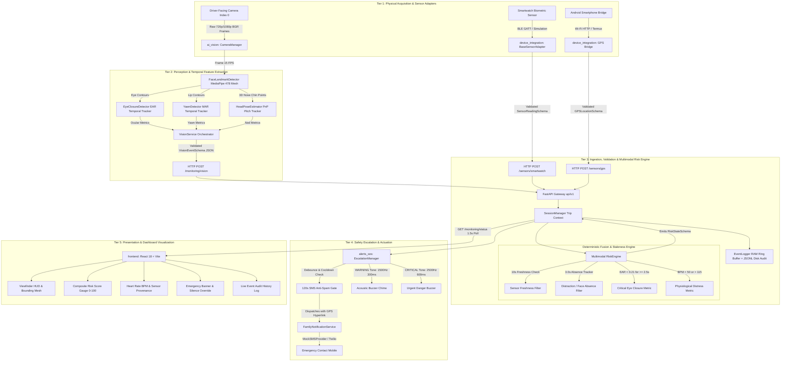

# Multimodal Driver Drowsiness and Health Monitoring System
## End-to-End System Architecture Specification

---

## 1. High-Level Modular Architecture

The system implements a decoupled, five-tier architecture ensuring strict separation of concerns, deterministic data flow, and independent team module development.

---

## 2. End-to-End Pipeline Stages

### Stage 1: Physical Acquisition & Temporal Feature Extraction
* **Frame Acquisition**: Handled by `CameraManager` at 15 FPS with rate-throttling. If frame reads drop consecutive frames (> 5), an automatic hardware reconnection handler executes without crashing the process.
* **Topological Facial Landmarks**: Extracted via MediaPipe FaceMesh (478 topological vertices).
* **Temporal Ocular Analysis**:
  $$EAR = \frac{||p_2 - p_6|| + ||p_3 - p_5||}{2 \cdot ||p_1 - p_4||}$$
  Continuous eyelid closure duration is measured in milliseconds. If $EAR < 0.21$ continuously for $\ge 1500\text{ ms}$, it flags moderate drowsiness; if $\ge 2500\text{ ms}$, it flags critical micro-sleep.
* **Temporal Yawn Analysis**:
  $$MAR = \frac{||p_{\text{top}} - p_{\text{bottom}}||}{||p_{\text{left}} - p_{\text{right}}||}$$
  Differentiates short conversational speech phonemes from sustained physiological yawning ($\ge 1800\text{ ms}$).
* **Head Pose Estimation**: Approximate 3D Pitch angle relative to baseline upright posture detects downward head nodding.

### Stage 2: Biometric & Geographical Telemetry Ingestion
* **Biometric Telemetry**: Ingested via `BaseSensorAdapter`. If physical hardware is disconnected, the adapter outputs `UNAVAILABLE` and `None` for BPM. **Missing readings are never represented as 0**.
* **GPS Telemetry**: Ingested via Android HTTP bridge or simulated position coordinates into `GPSLocationSchema`.

### Stage 3: Multimodal Fusion & Temporal Staleness Engine
* **Freshness Verification**: If `sensor_reading.timestamp` is older than `10.0 seconds`, the data status transitions to `STALE` and the reading is ignored to prevent stale data from biasing the safety score.
* **Missing-Face Distraction Tracking**: If the driver's face is missing for $\ge 3.0\text{ seconds}$ while driving, the system raises a `WARNING` state for distraction/occlusion.
* **Multimodal Score Fusion**: The `RiskEngine` calculates a normalized composite risk score ($0.0 \text{ to } 100.0$) and categorizes the vehicle into:
  - `NORMAL` (Score < 40.0)
  - `WARNING` (Score 40.0 – 79.9)
  - `HIGH_RISK` (Score $\ge 80.0$)
  - `MONITORING_UNAVAILABLE` (Telemetry degraded or unreadable)

### Stage 4: Alert Escalation & Anti-Spam Gate
* **Tier 1 (`WARNING`)**: Acoustic chime (1500 Hz, 300 ms) warns driver. Family SMS is withheld to prevent false alarms.
* **Tier 2 (`HIGH_RISK`)**: High-pitch acoustic buzzer (2500 Hz, 600 ms) sounds continuously. Emergency SMS with driver identity, incident rationale, and Google Maps GPS coordinates is dispatched.
* **120-Second Cooldown**: Prevents spamming emergency contacts during sustained incidents.
* **Manual Override**: The driver can acknowledge the alert via the dashboard or API to mute the buzzer.

### Stage 5: Real-Time Visualization
* The React dashboard polls `GET /api/v1/monitoring/status` every 1.5 seconds, visualizing telemetry without running computer vision inference inside the browser DOM.
